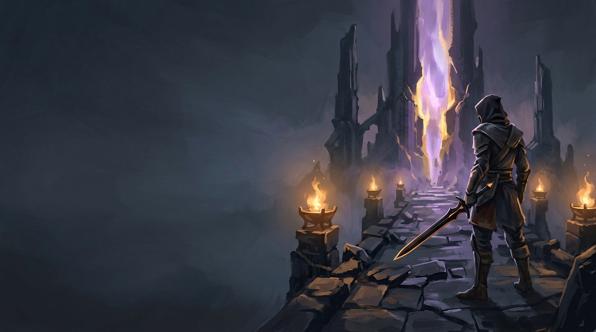

# ⚔️ Shadow Rift — 3D Dark-Fantasy Action RPG

A fast-paced, atmospheric top-down 3D action RPG built with **Three.js**, **React 19**, and **Vite**. Descend through procedurally generated themed dungeons, slash through hordes of shadowy creatures, forge void-touched equipment at the Rift Forge, unlock deep skill tree branches, and commune with the **Gemini AI Void Oracle**.



---

## 🌟 Key Features

* **Procedural Themed Dungeons**:
  * Endless dungeon generation featuring 4 distinct regional themes: *Obsidian Catacombs*, *Ember Forge*, *Astral Sanctum*, and *Blighted Crypt*.
  * Connected rooms, hazard traps (floor spikes, void geysers, shadow snares), pillars, and harvestable mineral nodes.
* **Fluid Real-Time Combat**:
  * 3-hit combo melee slashing with dynamic hitstop, screen shake, and critical strike finishers.
  * Dash with invulnerability frames (I-frames) and trailing ghost afterimages.
  * **Rift Nova**: Radial kinetic shockwave that stuns surrounding monsters.
  * **Astral Lance**: Piercing high-velocity projectile that shreds enemy lines.
* **Rift Forge & Crafting**:
  * Harvest minerals (*Shadow Iron*, *Ember Ash*, *Rift Shards*, *Vital Essence*) to craft specialized weapons, armor, and alchemical flasks.
* **Three-Branch Skill Tree**:
  * **Combat**: Whirlwind Finishers, Bloodlust, Executioner Shockwaves.
  * **Magic**: Astral Lance, Nova Stun Amplification, Void Singularities.
  * **Utility**: Phase Step Dash Damage, Shadow Clones, Material Magnets.
* **Procedural Dark-Ambient Music & Synth Audio**:
  * Fully synthesized Web Audio API sound effects and theme-matched procedural sub-bass drones with live volume controls.
* **Void Oracle (Powered by Google Gemini 2.5)**:
  * In-game shrine whispering dynamic, contextual prophecies and tactical clues using `@google/genai` (with offline ancient rune fallback).
* **Rift Codex & Bestiary**:
  * Comprehensive in-game field guide (`B`) detailing monster profiles, threat levels, vulnerabilities, and lore.
* **Multi-Platform Controls**:
  * 🎮 **Full Gamepad / Controller Support**: Twin-stick movement & aiming with complete button mappings for Xbox, PlayStation, and generic gamepads.
  * 📱 **Mobile Touch Controls**: Floating virtual analog thumbstick, responsive action buttons, and smart auto-aiming.
  * ⌨️ **Keyboard & Mouse**: Classic WASD, mouse-aiming, and shortcut keys.
* **PWA & Android Install Ready**:
  * Web App Manifest, maskable app icons, and offline Service Worker for 1-tap installation on Android and Desktop.
* **Mid-Run Persistence**:
  * Auto-saves run progress upon clearing chambers or pausing, allowing players to resume mid-descent if interrupted.

---

## 🎮 Controls

| Action | Keyboard / Mouse | Gamepad / Controller | Mobile Touch |
| :--- | :--- | :--- | :--- |
| **Move** | `W` `A` `S` `D` / Arrows | **Left Stick** / D-Pad | Floating Left Thumbstick |
| **Aim** | Mouse Cursor | **Right Stick** / Movement | Smart Auto-Aim |
| **Slash / Combo** | Left Click / `J` | `X` / `RT` (Right Trigger) | Slash Button (Hold to Combo) |
| **Dash (I-Frames)** | `Space` / `Shift` | `B` / `LT` (Left Trigger) | Dash Button |
| **Rift Nova** | `Q` / Right Click | `RB` (Right Bumper) | Nova Button |
| **Astral Lance** | `V` / `2` | `LB` (Left Bumper) | Lance Button |
| **Healing Flask** | `E` | `Y` / `D-Pad Up` | Flask Button |
| **Interact / Harvest** | `F` | `A` / Cross | Interact Button |
| **Rift Forge** | `C` | `D-Pad Left` | Forge HUD Button |
| **Skill Tree** | `K` | `Back` / `Select` | Skills HUD Button |
| **Rift Codex** | `B` | `D-Pad Right` | Codex HUD Button |
| **Void Oracle** | `O` | Pause Menu | Oracle HUD Button |
| **Pause / Resume** | `Esc` / `P` | `Start` / `Options` | Pause HUD Button |
| **Mute Audio** | `M` | Pause Menu | Mute HUD Button |

---

## 🚀 Getting Started

### Prerequisites

* [Node.js](https://nodejs.org/) (v18+)
* npm (or bun)

### 1. Installation

Clone the repository and install dependencies:
```bash
git clone https://github.com/kamepalliakhilesh-cpu/Shadow-Rift.git
cd Shadow-Rift
npm install
```

### 2. Configure Gemini AI (Optional)

To enable dynamic AI prophecies from the Void Oracle:
1. Copy `.env.example` to `.env.local`:
   ```bash
   cp .env.example .env.local
   ```
2. Set your [Google AI Studio API Key](https://aistudio.google.com/):
   ```env
   VITE_GEMINI_API_KEY="your-api-key-here"
   ```
*(You can also paste your API key directly inside the in-game Void Oracle modal).*

### 3. Run Locally

```bash
npm run dev
```
Open [http://localhost:3000](http://localhost:3000) in your browser.

---

## 📦 Scripts

* `npm run dev` — Starts the local Vite development server.
* `npm run build` — Compiles the production build into `dist/`.
* `npm test` — Runs the automated 9-scenario systems test suite (`tsx --test`).
* `npm run lint` — Type-checks all TypeScript files (`tsc --noEmit`).
* `npm run clean` — Cross-platform clean of build output.

---

## 📱 Installing on Android

Shadow Rift is a fully certified Progressive Web App (PWA):
1. Start the dev server accessible to your network: `npm run dev -- --host` (or deploy to HTTPS).
2. Visit the URL on an Android device using Google Chrome.
3. Tap **"Install App"** on the title screen or select **"Install app"** from Chrome's menu.
4. The game will install directly to your Android App Drawer & Home Screen as a standalone fullscreen game with offline play capability.

---

## 📜 License

MIT License. Crafted with Three.js, React, and Google Gemini.
